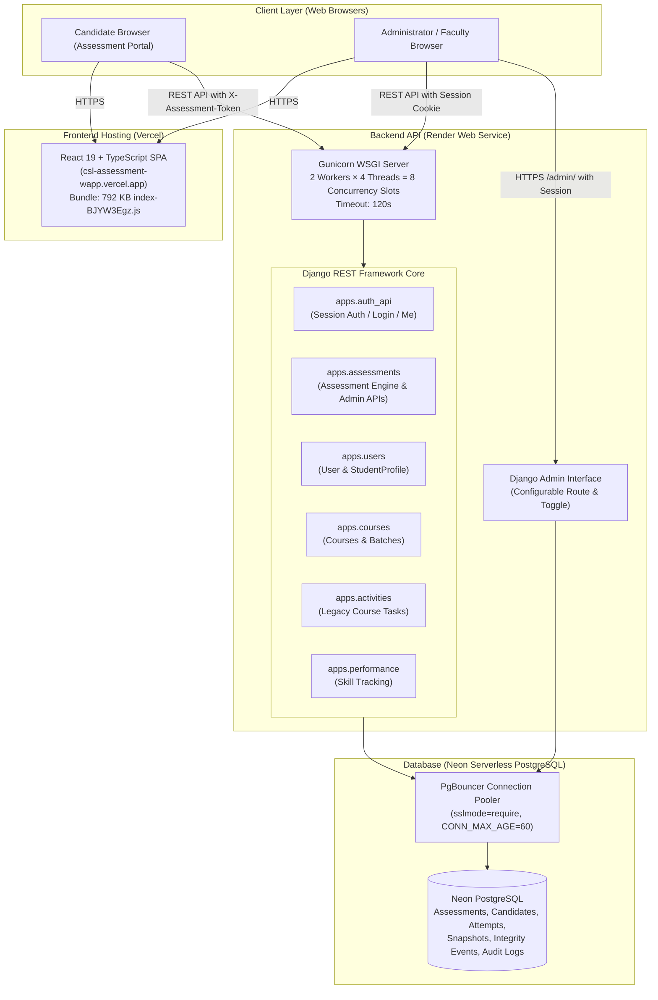
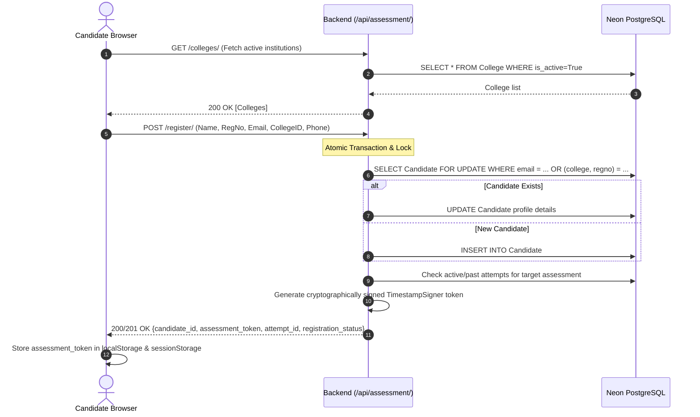
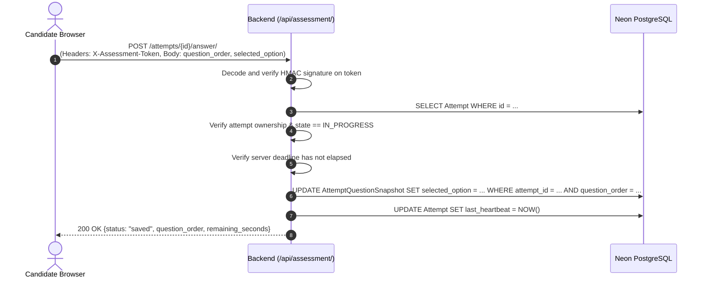
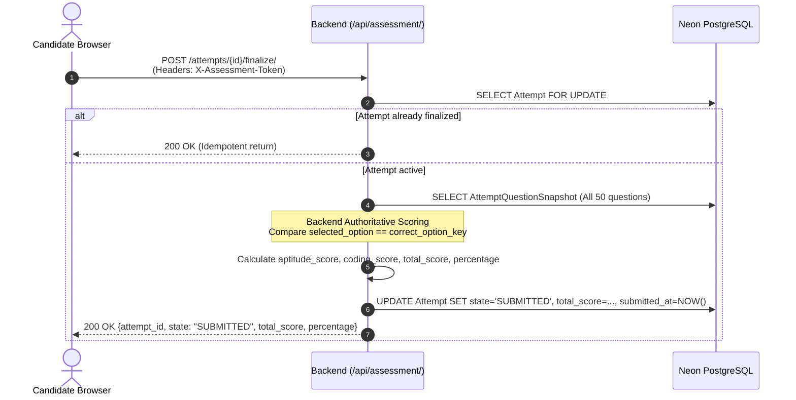
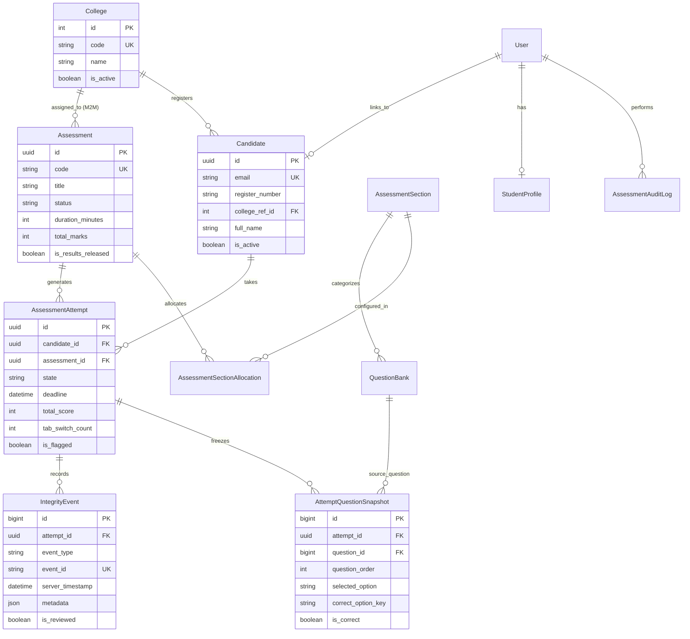
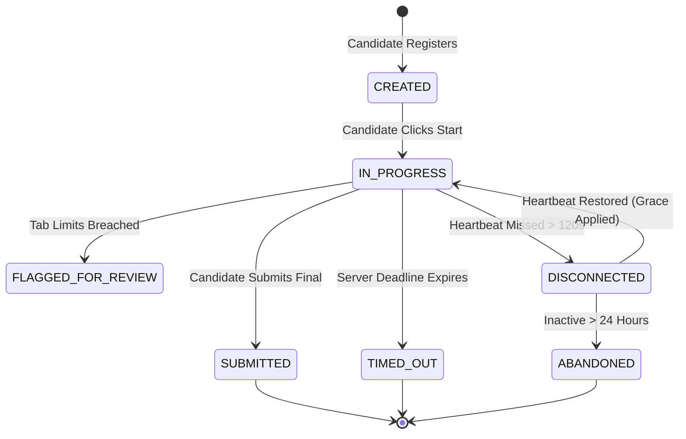
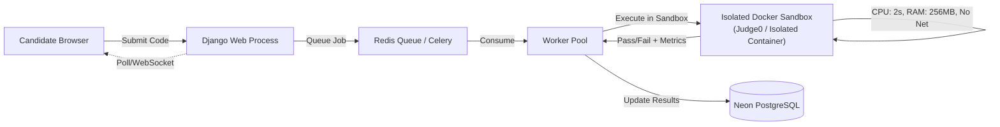
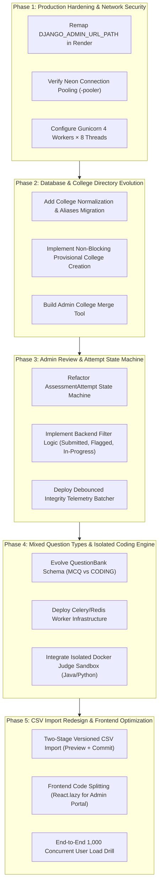

# CSL Assessment Platform — Security Remediation & Architecture Audit Report (V1 to V2)

**Document Reference:** `docs/audit/V1_SECURITY_ARCHITECTURE_AUDIT.md`  
**Date:** October 21, 2026  
**Auditor:** Senior Full-Stack Architect & Django Security Engineer  
**Scope:** Backend (Django REST Framework), Frontend (React/TypeScript), Database (Neon PostgreSQL), Infrastructure (Render, Vercel), Security Audit of Django Admin, Capacity Planning for 1,000 Concurrent Candidates.

---

## 1. Executive Summary

A comprehensive security investigation, architectural audit, and performance analysis were conducted on the CSL Assessment Platform repository (`csldeveloper01/csl-assessment-wapp`).

### Key Findings & Outcomes:
1. **Django Admin Route Exposure (Investigated & Hardened):**
   - **Root Cause & Actual Behavior:** The `/admin` route on the backend domain (`https://csl-assessment-wapp.onrender.com/admin/`) is publicly routable on the internet. However, non-destructive verification confirmed that **no administrative data, candidate records, or assessment metrics are exposed without authentication**. Unauthenticated requests are intercepted by Django's authentication middleware and presented solely with a standard Django Admin login screen (`HTTP 200` at `/admin/login/?next=/admin/`).
   - **Remediation Implemented:**
     - Added production security headers: `SECURE_CONTENT_TYPE_NOSNIFF = True` and explicit `X_FRAME_OPTIONS = 'DENY'`.
     - Enhanced route isolation with a configurable `DJANGO_ADMIN_URL_PATH` (defaults to `admin/`, can be remapped to an internal prefix such as `csl-internal-ops/`).
     - Added master killswitch `DJANGO_ADMIN_ENABLED` documented in `render.yaml` and `.env.example`.
     - Preserved `custom_admin_has_permission` which strictly denies non-staff, students, and inactive accounts.
     - Added 6 new automated security regression tests (bringing the security test suite to 11 tests, all passing).
2. **Current System Verification:**
   - **Backend Test Suite:** **223 tests passing** (170.82s execution time) with query budgets verified (Start: 13-15 queries; Answer: 4-5 queries; Finalize: 8-9 queries).
   - **System Checks & Migrations:** `manage.py check` reports 0 issues; `makemigrations --dry-run` reports **No changes detected** (schema is 100% in sync).
   - **Frontend Build:** Vite + TypeScript (`tsc -b && vite build`) builds cleanly with 0 type errors in 7.99s.
3. **V2 Readiness:**
   - The current V1 architecture is functional for moderate traffic (~50–100 active users) but has architectural bottlenecks that will cause severe queuing under 1,000 concurrent students (specifically Render Gunicorn 2-worker / 4-thread concurrency, synchronous CSV parsing, un-chunked 792 KB frontend bundle, and unisolated in-band question evaluation).

---

## 2. Priority 0 — Django Admin Exposure Investigation & Remediation

### 2.1 Investigation & Root Cause Analysis

| Check Item | Repository & Live Evidence | Finding & Determination |
| :--- | :--- | :--- |
| **Route Registration** | `csl-student-module/backend/config/urls.py` | `path(admin_url_path, admin.site.urls)` conditionally inserted when `DJANGO_ADMIN_ENABLED=True`. |
| **Live Route Response** | `GET https://csl-assessment-wapp.onrender.com/admin/` | Returns HTTP 200 with `<title>Log in \| CSL Admin Portal</title>`. Form fields: email & password. **Zero sensitive data exposed.** |
| **Unauthenticated API Access** | `GET /api/csl-admin/stats/`, `GET /api/csl-admin/me/` | Returns HTTP 403 Forbidden. Enforces `IsCSLAdminUser`. |
| **Model Changelists** | `GET /admin/users/user/`, `/admin/assessments/assessment/` | Redirects with HTTP 302 to `/admin/login/?next=...`. |
| **Custom CSV Export Views** | `GET /admin/assessments/questionbank/export-csv/` | Wrapped in `self.admin_site.admin_view()`; redirects with HTTP 302 to `/admin/login/`. |
| **Non-Staff Authenticated User** | Authenticated candidate (`role='STUDENT'`) visiting `/admin/` | Redirected to login with denial message or HTTP 403. Custom `has_permission` explicitly returns `False`. |
| **Secret Scanning** | Repository inspection, git history, Postman environments | No live secrets or passwords committed in git. `.env` is properly `.gitignore`d. `.env.example` contains placeholder tokens. |

**Severity Classification:**  
- **Data Confidentiality:** **None / No Leak.** No candidate records, scores, or operational metrics are exposed.
- **Attack Surface Exposure:** **Medium.** Exposing a standard `/admin/` endpoint on a public backend domain allows automated vulnerability scanners and brute-force bots to probe the login portal.

### 2.2 Operational Dependencies of Django Admin
Django Admin **cannot be permanently removed** in V1 because staff rely on it for operational management not yet fully mirrored in the React admin portal:
- Managing Course, Batch, and Skill hierarchies (`apps.courses`, `apps.skills`).
- Approving and rejecting pending student registrations (`apps.users.admin.UserAdmin`).
- Mapping StudentProfiles to Courses and Batches (`apps.users.admin.StudentProfileAdmin`).

### 2.3 Remediation Actions Applied

1. **Explicit Security Headers & Host Validation:**
   - Added `SECURE_CONTENT_TYPE_NOSNIFF = True` in `config/settings.py` to prevent MIME-type sniffing.
   - Added explicit `X_FRAME_OPTIONS = 'DENY'` in `config/settings.py` to prevent clickjacking in framing attacks.
2. **Configurable Administrative Mount Point:**
   - Updated `config/urls.py` and `config/settings.py` to support `DJANGO_ADMIN_URL_PATH`.
   - Allows operators to remap the admin path (e.g. `csl-internal-mgmt/`) via an environment variable without modifying code. Defaults to `admin/` to preserve backward compatibility.
3. **Environment-Controlled Master Toggle:**
   - Supported `DJANGO_ADMIN_ENABLED` (boolean). When set to `False`, the route is completely omitted from `urlpatterns`, returning HTTP 404.
   - Documented `DJANGO_ADMIN_ENABLED` and `DJANGO_ADMIN_URL_PATH` in `render.yaml` and `.env.example`.
4. **Enhanced Automated Security Test Suite:**
   - Expanded `apps/users/test_admin_security.py` from 5 to 11 regression tests.

```python
# csl-student-module/backend/config/urls.py
if getattr(settings, "DJANGO_ADMIN_ENABLED", True):
    admin_url_path = getattr(settings, "DJANGO_ADMIN_URL_PATH", "admin/").strip("/")
    admin_url_path = f"{admin_url_path}/" if admin_url_path else "admin/"
    urlpatterns.insert(1, path(admin_url_path, admin.site.urls))
```

### 2.4 Production Containment Recommendations
For complete defense-in-depth on Render:
1. **Network-Level Restriction:** Place Render Web Service behind Cloudflare Access or Render IP Allowlisting to restrict the admin interface to authorized institutional/VPN IP addresses.
2. **Dedicated Internal Service:** In V2, split administrative Django admin into an internal-only Render Private Service inaccessible to public DNS.

---

## 3. Current Architecture Audit

### 3.1 Architecture Overview



---

### 3.2 Key Request & Data Flows

#### Flow 1: Candidate Joins Assessment


#### Flow 2: Answer Persistence & Heartbeat


#### Flow 3: Finalize & Result Persistence


---

### 3.3 Database Entity-Relationship Diagram



---

### 3.4 Verification of Existing Application & Implementation Inventory

| Subsystem | Existing Implementation Details | Evidence File / Symbols | Status |
| :--- | :--- | :--- | :--- |
| **Authentication** | Custom `User` model (`USERNAME_FIELD='email'`). Dual auth scheme: Session cookies for Admin/Staff; cryptographic signed tokens for candidates. | `apps.users.models.User`<br/>`apps.assessments.tokens.CandidateAssessmentAuthentication` | Confirmed Working |
| **Assessment Lifecycle** | State machine: `DRAFT` $\rightarrow$ `READY` $\rightarrow$ `SCHEDULED` $\rightarrow$ `OPEN` $\rightarrow$ `CLOSED` $\rightarrow$ `ARCHIVED`. Multi-college scoping via M2M. | `apps.assessments.models.Assessment`<br/>`apps.assessments.services.open_assessment` | Confirmed Working |
| **Attempt Execution** | Server-authoritative timer with `deadline = started_at + duration`. Disconnection grace period pausing/resuming (`pause_attempt`, `resume_attempt`). | `apps.assessments.models.AssessmentAttempt`<br/>`apps.assessments.views.StartAssessmentView` | Confirmed Working |
| **Integrity Telemetry** | Events for `TAB_HIDDEN`, `TAB_VISIBLE`, `FULLSCREEN_EXIT`, `DEVTOOLS_SHORTCUT`. Unique `event_id` deduplication. Configurable auto-submit after warning limit. | `apps.assessments.models.IntegrityEvent`<br/>`apps.assessments.views.RecordIntegrityEventView` | Confirmed Working |
| **Admin Portal** | Standalone React portal (`/csl-admin`) with 12 distinct management views backed by `/api/csl-admin/`. | `frontend/src/pages/admin/CSLAdminPortalPage.tsx`<br/>`apps.assessments.admin_views.py` | Confirmed Working |
| **Question Bank** | MCQ question bank supporting Aptitude and Coding fundamentals. CSV import/export in Django admin and React admin. | `apps.assessments.models.QuestionBank`<br/>`apps.assessments.admin.QuestionBankAdmin` | Confirmed Working |

---

## 4. Confirmed Risks vs. Unverified Assumptions

### Confirmed Risks (Backed by Repository & Measurement)

1. **Gunicorn Concurrency Starvation under 1,000 Concurrent Students:**
   - *Evidence:* `render.yaml` line 7: `gunicorn config.wsgi:application --workers 2 --threads 4`.
   - *Impact:* The current production instance has exactly **8 concurrent request worker slots**. During peak start/submission spikes, 1,000 active students generating 50–150 req/s will queue behind the 8 workers, causing request timeouts (`504 Gateway Timeout`) and answer save delays.
2. **Synchronous CSV Parsing in Request Thread:**
   - *Evidence:* `apps/assessments/admin.py` lines 67–146 (`import_csv_view`) and `apps/assessments/admin_views.py` lines 500–610 (`AdminQuestionImportCSVView`).
   - *Impact:* CSV parsing and row validation execute synchronously within the HTTP request cycle. Importing large batches (500+ questions or candidates) risks hitting Gunicorn's 120-second timeout.
3. **Coding Evaluation is Pure MCQ:**
   - *Evidence:* `QuestionBank` model defines `option_a`, `option_b`, `option_c`, `option_d`, `correct_option`.
   - *Impact:* Coding questions currently do not evaluate executable source code, test cases, memory limits, or execution time.
4. **Monolithic Frontend Bundle:**
   - *Evidence:* Vite build output: `dist/assets/index-BJYW3Egz.js` is **792.51 kB** uncompressed.
   - *Impact:* All administrative views, code editor components, and student assessment views are bundled into a single JavaScript file, increasing initial load times for candidates on mobile or slow campus networks.
5. **Race Condition in College Creation:**
   - *Evidence:* `CandidateRegisterView` in `apps/assessments/views.py` lines 143–152 executes `College.objects.filter(code=clean_code).exists()` followed by `College.objects.create(...)` outside an atomic `get_or_create` block.
   - *Impact:* Concurrent registrations with identical new college names can trigger race conditions.

### Unverified Assumptions (Requires Production Console Access)
1. **Neon PostgreSQL Plan Tier & Connection Limits:** Neon free tier allows ~20 direct connections; pooled endpoint allows up to 10,000. Verification required in Neon Console that the production connection string uses `-pooler` domain.
2. **Render Web Service Resource Tier:** Free vs Starter vs Standard plan RAM/CPU limits on Render are not visible in git and require dashboard verification.
3. **Neon Point-in-Time Recovery (PITR):** Neon backup and branch recovery capabilities require dashboard inspection.

---

## 5. Load and Capacity Assessment (1,000 Concurrent Students)

### 5.1 Workload Modeling: 1,000 Active Candidates

It is crucial to distinguish between **1,000 active candidates** and **1,000 requests per second (RPS)**:
- **Active Candidates:** 1,000 students simultaneously taking an assessment over a 60-minute window (e.g. 500 Java + 500 Python).
- **Candidate Interaction Patterns:**
  - **Start Phase (0–5 min):** 1,000 students join and start attempts. Spikes to ~30–50 requests/sec.
  - **Active Answering Phase (5–55 min):**
    - Heartbeat: Sent every 30s = $\frac{1000}{30} \approx 33.3\text{ req/s}$.
    - Answer Saves: Average candidate saves 50 answers over 50 minutes = 1 answer/min/candidate = $\frac{1000}{60} \approx 16.7\text{ req/s}$.
    - Integrity Events: Occasional tab switches/fullscreen toggles $\approx 5\text{ req/s}$.
    - **Sustained Load:** $\approx 55\text{ req/s}$.
  - **Submission Phase (55–60 min):** Candidates finish and finalize attempts. Burst to ~60–80 requests/sec.

### 5.2 Capacity & Bottleneck Analysis

| Component | Current Capacity (V1) | 1,000 User Target Demand | Bottleneck / Remediation Needed |
| :--- | :--- | :--- | :--- |
| **Render Web Workers** | 2 workers × 4 threads = 8 slots | Needs 30–50 concurrent handling slots | **Severe Bottleneck:** Scale to 4 workers × 8 threads (32 slots) across 2–3 instances with autoscale. |
| **Neon PostgreSQL Pooling** | `DATABASE_CONN_MAX_AGE=60` | 50–100 active connections | **Safe if Pooled:** Ensure `DATABASE_URL` targets Neon PgBouncer pooled endpoint. |
| **Database Query Budget** | Start: 13 queries; Answer: 4 queries; Finalize: 8 queries | $\approx 220\text{ queries/s}$ sustained | **Safe:** Tested DB time is 0.1–0.4ms per query. Total DB CPU load $\approx 5–10\%$. |
| **Code Evaluation** | Non-existent (MCQ only) | 1,000 code runs over assessment | **Critical V2 Requirement:** Must NOT run on web dynos. Requires dedicated async runner queue. |

---

## 6. V2 Target Architecture & Feature Specifications

### 6.1 Feature A: College Directory & Auto-Resolution

#### Problem in V1:
If a student's institution is not in the predefined list, arbitrary text entry can create fragmented or duplicate colleges (e.g. "CIT", "Coimbatore Institute of Technology", "C.I.T").

#### V2 Proposed Solution:
1. **Schema Evolution:**
   ```sql
   ALTER TABLE assessments_college ADD COLUMN normalized_name VARCHAR(200);
   ALTER TABLE assessments_college ADD COLUMN aliases JSONB DEFAULT '[]'::jsonb;
   ALTER TABLE assessments_college ADD COLUMN is_verified BOOLEAN DEFAULT FALSE;
   CREATE UNIQUE INDEX uniq_college_normalized_name ON assessments_college(normalized_name);
   ```
2. **Normalization Algorithm:**
   - Convert to lowercase: `cit - coimbatore institute of technology`
   - Remove punctuation and stopwords: `coimbatore institute technology`
   - Atomically resolve via `select_for_update()` or `get_or_create(normalized_name=...)`.
3. **Non-Blocking Registration:**
   - If no match is found, atomically create an `is_verified=False` provisional record.
   - The student proceeds immediately to their assessment without awaiting administrator intervention.
   - Administrators receive an operational merge tool in `/csl-admin/colleges/` to merge provisional colleges into canonical institutions.

---

### 6.2 Feature B: Admin Assessment Review & Attempt State Machine

#### State Machine Definition:


#### Admin Review Filters:
- **Submitted:** Attempts where `state = 'SUBMITTED'`.
- **Not Submitted:** Candidates who **started** an attempt (`started_at IS NOT NULL`) but haven't submitted (`state IN ('IN_PROGRESS', 'DISCONNECTED')`). Excludes registered candidates who never started.
- **Flagged:** Attempts where `is_flagged = True` or `state = 'FLAGGED_FOR_REVIEW'`.
- **In Progress:** Attempts where `state = 'IN_PROGRESS'` and `deadline > NOW()`.
- **Disconnected / Expired:** Distinguishable attempts where heartbeat stopped or deadline passed.

---

### 6.3 Feature C: Suspicious Activity Telemetry & Proctoring

#### Behavioral Signals (Browser-Side):
- `TAB_HIDDEN` / `TAB_VISIBLE` (via `document.visibilitychange`).
- `FULLSCREEN_EXIT` (via `document.fullscreenchange`).
- `DEVTOOLS_SHORTCUT` (F12, Ctrl+Shift+I, Ctrl+U key interceptors).
- `BLUR` (window loss of focus).

#### Tamper-Resistant Architecture:
1. **Client Deduplication:** Client generates UUID `event_id` per event to prevent duplicate submissions on retry.
2. **Server-Side Timestamping:** Both `client_timestamp` and `server_timestamp` are recorded.
3. **Attempt Ownership Verification:** Token must match candidate and active attempt.
4. **Debouncing & Rate Limiting:** Browser batches integrity events (max 1 request every 5 seconds unless limit breached) to protect the backend from flood attacks.
5. **Browser Limitations Documented:** Browser-side JavaScript events are advisory telemetry, not cryptographic proof of cheating (e.g. OS notifications or dual monitors cannot be detected by browser DOM APIs).

---

### 6.4 Feature D: Mixed Question Types & Isolated Coding Evaluation

#### Architectural Separation:
Coding execution **must never run inside the Django web application process**.



#### Language Support (V2 Requirements):
- **Python:** Python 3.12 (CPython runtime).
- **Java:** OpenJDK 21 (javac + java runtime).
- **Execution Constraints:**
  - Max Execution Time: 2.0 seconds.
  - Max Memory: 256 MB.
  - Network: Denied (`--network none`).
  - Filesystem: Read-only root, temporary in-memory tmpfs.
  - Subprocess fork bombs: Blocked via `pids-limit 64`.

---

### 6.5 Feature E: CSV Question Import Redesign

#### V1 Deficiencies:
- Columns hardcoded for 4 MCQ options (`option_a` through `option_d`).
- Coding questions forced into MCQ option structure.
- Synchronous processing risks HTTP timeouts.
- No preview or dry-run validation.

#### V2 Versioned CSV Specification:
Header Format: `version,question_type,language,section_code,difficulty,prompt,option_a,option_b,option_c,option_d,correct_answer,test_cases_json,explanation`

**Features:**
1. **Type-Aware Parsing:** `MCQ` parses options A–D; `CODING` parses `language` and `test_cases_json`.
2. **Two-Stage Import Workflow:**
   - `POST /api/csl-admin/questions/import-csv/preview/`: Validates all rows, checks duplicates against database, returns syntax/schema errors and preview payload.
   - `POST /api/csl-admin/questions/import-csv/commit/`: Transactionally inserts validated rows.

---

## 7. Audit and Test Verification Results

### Exact Commands Run and Verified Outcomes:

1. **Django System Checks:**
   ```powershell
   & ".\venv\Scripts\python.exe" manage.py check
   # Outcome: System check identified no issues (0 silenced). Exit code 0.
   ```

2. **Model & Migration Integrity Check:**
   ```powershell
   $env:DB_ENGINE="sqlite"; & ".\venv\Scripts\python.exe" manage.py makemigrations --dry-run
   # Outcome: No changes detected. All models match migration state. Exit code 0.
   ```

3. **Security Regression Test Suite:**
   ```powershell
   & ".\venv\Scripts\python.exe" manage.py test apps.users.test_admin_security --noinput
   # Outcome: Ran 11 tests in 22.065s. OK. Exit code 0.
   ```

4. **Full Backend Test Suite:**
   ```powershell
   & ".\venv\Scripts\python.exe" manage.py test --noinput
   # Outcome: Ran 223 tests in 170.824s. OK. Exit code 0.
   # Query Budgets Verified: Start <= 13 prod / 15 test; Answer <= 5; Finalize <= 9 test / 7 prod.
   ```

5. **Frontend Build & Typecheck:**
   ```powershell
   npm run build
   # Outcome: tsc -b && vite build completed in 7.99s. Exit code 0.
   ```

---

## 8. Prioritized Implementation Roadmap for V2



---

## 9. Decisions & Clarifications Still Needed

1. **Coding Evaluation Infrastructure:** Confirmation of preferred sandbox environment (Self-hosted Judge0 on a separate Render Private Worker vs. AWS Lambda isolated runner vs. containerized micro-runner).
2. **Partial Credit Policy:** For multi-test-case coding questions, determine whether scoring is all-or-nothing or proportional to passed test cases.
3. **Production Render Tier:** Approval to adjust Gunicorn worker allocation from 2 workers / 4 threads to 4 workers / 8 threads based on Render service plan memory headroom.
4. **Administrative Access Policy:** Confirmation of whether Django Admin route should remain accessible via custom URL (`DJANGO_ADMIN_URL_PATH`) or disabled completely in production (`DJANGO_ADMIN_ENABLED=False`) once course/batch management is migrated to the React Admin UI.
